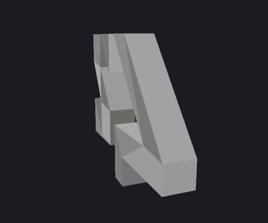
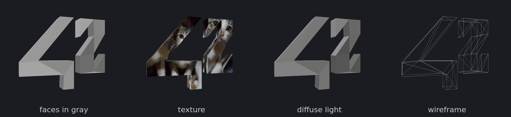
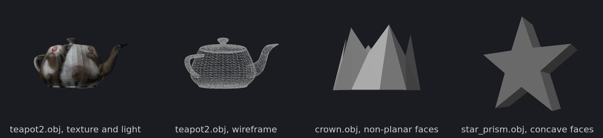

# scop

## 📖 About

"scop" is an introduction to **GPU rendering** written in **C** with **OpenGL
4.1 core**: a small viewer that loads a 3D model from a Wavefront `.obj` file
and shows it in a window, in perspective, turning slowly around its own
vertical axis.

The model can be rotated and moved along its three axes from the keyboard.
Every face of the `.obj` gets its own shade of gray, so the shape reads even
without a light, and one key fades a texture in and out over the model with a
smooth transition. A soft diffuse light, a wireframe mode and a point mode can
be switched on in the same way.

Apart from the window and the keyboard, handled by **GLFW**, everything is
written from scratch: the `.obj` parser, the vector and matrix math, the
shader loading, the BMP texture loader and even the OpenGL function loader —
there is no GLAD, GLEW, GLM or image library, and no OpenGL header is needed
to build.

Beyond the mandatory part, scop triangulates concave and non-planar faces by
**ear clipping**, maps the texture **triplanar** so that no face stretches it,
takes an optional texture on the command line and shows the frame rate in the
window title.

<details>
<summary><strong>🖼️ Screenshots</strong></summary>

<br>

<p align="center">
  
</p>

<p align="center"><sub><code>./scop resources/42.obj</code>: one full turn, with <code>T</code> pressed twice to fade the texture in and out.</sub></p>

<br>

</details>

## 🎯 Objectives

- Opening an OpenGL 4.1 core context and loading every GL function it uses by
  hand, through `glfwGetProcAddress`
- Parsing an untrusted `.obj` file and refusing a malformed one with its line
  and the reason
- Turning any polygon into triangles, including concave and non-planar ones
- Writing the 4x4 matrix math of a model, a look-at camera and a perspective
  projection, with no math library
- Uploading a mesh to the GPU (VAO, VBO) and drawing it with two hand-written
  GLSL shaders
- Centering and scaling any model so that it turns around its own center and
  fits the view
- Decoding BMP files into a texture, and projecting that texture onto a model
  that has no texture coordinates
- Driving transitions, rotations and movements by time, not by frame count
- Releasing every resource, with a valgrind run that reports no leak of the
  program

## 📋 Function Overview

<details>
<summary><strong>scop — modules breakdown</strong></summary>

<br>

| Module | Feature | Description |
|--------|---------|-------------|
| **app** | Arguments | `<model.obj> [texture.bmp] [width height]`; names need a name before their extension, sizes stay within 1280x720 and 3840x2160 |
| **app** | Start-up | Model and texture are read before the window opens, so a bad file fails without one; `Ctrl+C` is caught from the very start |
| **app** | Main loop | Poll events, update the view and the fades with the frame time, draw, swap; capped at 240 FPS when the driver ignores vsync |
| **app** | Input | Toggles on key press (texture, mapping, light, draw mode, pause, reset, HUD), held keys read every frame for rotation and movement |
| **app** | View | Model matrix: translation, rotations around Z and X, then the spin around the model's own Y axis |
| **app** | HUD | `scop  /  FPS:<rate> \| '<model path>' \|` in the title, refreshed every 0.25 s while `H` shows it |
| **obj** | Two passes | Vertices first, faces second, so an `f` line may name a vertex defined after it |
| **obj** | Faces | Corners `v`, `v/vt`, `v//vn` or `v/vt/vn`; negative indices count back from the face's own line; `vt`, `vn`, `o`, `g`, `s`, `usemtl`, `mtllib` are skipped |
| **obj** | Triangulation | Triangles kept as they are, larger polygons ear-clipped in the plane of their Newell normal (a fan when that normal has no length); degenerate triangles dropped |
| **obj** | Errors | The file, the line and the offending token: `bad.obj:3: vertex index out of range '9'` |
| **image** | BMP | 24 and 32 bits, uncompressed or byte-aligned `BI_BITFIELDS`, bottom-up or top-down, any header from `BITMAPINFOHEADER` to V5 |
| **gl** | Loader | One function pointer per GL 4.1 call the program makes, filled from a table of names once the context exists, returned by `gl()` |
| **gl** | Shaders | Compiled and linked from `shaders/`, with the driver's log printed on failure |
| **gl** | Mesh | One vertex per triangle corner: position, face normal and a gray level per `.obj` face from the golden-ratio sequence |
| **gl** | Texture | Uploaded mipmapped and repeating, on texture unit 0 |
| **math** | Vectors | `t_vec3` add, sub, scale, dot, cross, length, normalize (a zero vector stays zero), min, max |
| **math** | Matrices | Column-major `t_mat4`: identity, product, translation, rotations, perspective, look-at |
| **shaders** | Colour | Gray faces, planar or triplanar texture and diffuse light, each one mixed in by an eased 0 to 1 uniform |

<br>

</details>

<details>
<summary><strong>Usage Example & Testing</strong></summary>

### Build and run

```bash
make install                                                   # checks the compiler and pkg-config, builds GLFW if missing
make                                                           # builds ./scop with -O2 (system GLFW or a static one)
./scop resources/42.obj                                        # texture: resources/kittens.bmp by default
./scop resources/teapot2.obj resources/kittens.bmp 1920 1080
make run                                                       # ./scop resources/42.obj (ARGS="..." to change it)
make fclean                                                    # objects, binary and the GLFW build
```

The program runs from the repository root, where `shaders/` is found.

### Controls

| Key | Action |
|---|---|
| `W` / `S` | Rotate around the model's X axis |
| `A` / `D` | Rotate around the model's Y axis |
| `Q` / `E` | Rotate around the model's Z axis |
| `←` / `→` | Move along X |
| `↓` / `↑` | Move along Y |
| `F` / `R` | Move along Z, away / closer |
| `T` | Apply / remove the texture, with a smooth transition |
| `U` | Triplanar mapping (default) / a single planar projection |
| `L` | Soft diffuse light on / off, with a smooth transition |
| `M` | Drawing mode: filled faces, wireframe, points |
| `Space` | Pause / resume the automatic rotation |
| `Backspace` | Back to the initial position |
| `H` | Show / hide the frame rate and the model path in the title |
| `ESC` | Quit |

Rotation and movement keys act while held, at a speed that does not depend on
the frame rate: `π/2` rad/s for rotations, 1.5 units/s for movements, `π/4`
rad/s for the automatic spin.

<p align="center">
  
</p>

### Error handling

```bash
$ ./scop
Usage: ./scop <model.obj> [texture.bmp] [width height]
$ ./scop nope.obj
Error: nope.obj: No such file or directory
$ ./scop .obj
Error: '.obj' is not a .obj file
$ ./scop resources/42.obj resources/teapot.obj
Error: 'resources/teapot.obj' is not a .bmp file
$ ./scop bad.obj                                         # f 1 2 9 with two vertices
Error: bad.obj:3: vertex index out of range '9'
$ ./scop resources/42.obj bad.bmp
Error: bad.bmp: not a BMP file
```

Every refusal prints one line on standard error and exits with status 1, before
any window is opened.

### Valgrind

```bash
make valgrind   # accepts ARGS too
```

The window system, the toolkit that draws the window decorations and the
OpenGL driver keep global state until the process exits. Two suppression files
in `docs/` silence only that code, matched by library, never by a project
function:

| File | Valgrind | Contents |
|---|---|---|
| `docs/valgrind.supp` | every version | Wayland, X11, GTK / libdecor, GLib, D-Bus, fontconfig, Mesa, NVIDIA, libstdc++ and the glibc loader |
| `docs/valgrind_recent.supp` | 3.22 or newer | Two NVIDIA start-up errors whose kinds (`ReallocZero`, `BadSize`) older versions do not know |

`make valgrind` always loads the first file and adds the second only when the
installed valgrind accepts it. `--keep-debuginfo=yes` is required: the Mesa
driver is unloaded before the leak check, and without it its frames lose their
library name. A clean run ends with every lost and reachable counter at 0 and
`ERROR SUMMARY: 0 errors`, with the system GLFW or the static one.

<br>

</details>

## 🚀 Installation & Structure

<details>
<summary><strong>📥 Setup & Usage</strong></summary>

<br>

### Host requirements

| Tool | Needed for | Notes |
|------|------------|-------|
| `cc` (gcc or clang) | Compiling | `-Wall -Wextra -Werror -std=c11` |
| `make`, `pkg-config` | The build | `pkg-config` finds the system GLFW |
| GLFW 3 | Window and input | The only external library; downloaded and built if missing |
| An OpenGL 4.1 driver | Running | Mesa or NVIDIA, on X11 or Wayland |
| `curl` or `wget`, `cmake` | Only without a system GLFW | Download and static build of GLFW 3.5.1 |
| `valgrind` | `make valgrind` | Any version; 3.22+ also loads the second suppression file |

### GLFW

`make` uses the system GLFW when `pkg-config` finds it. Otherwise it downloads
GLFW 3.5.1 into `lib/`, checks it against a pinned SHA-256 and builds it as a
static library with `cmake`, without root. That build needs the X11
(`libx11-dev`, `libxrandr-dev`, `libxinerama-dev`, `libxcursor-dev`,
`libxi-dev`, `libxext-dev`) or Wayland (`libwayland-dev`, `libxkbcommon-dev`)
development files, and `make` stops naming what is missing. `make fclean` keeps
the downloaded sources, so a rebuild needs no network.

### Make targets

```bash
make install    # check the compiler and pkg-config, build GLFW when the system has none
make            # build ./scop (O=2 by default)
make O=0        # optimisation level: 0, 1, 2, 3, s or g; objects rebuild when the flags change
make run        # build and run with ARGS (resources/42.obj by default)
make valgrind   # build and run under valgrind with the suppression files
make clean      # remove obj/
make fclean     # clean + remove the binary and the GLFW build (sources kept)
make re         # fclean + build
```

### Running

```bash
./scop <model.obj> [texture.bmp] [width height]
```

| Argument | Default | Accepted |
|---|---|---|
| `model.obj` | — | A readable `.obj` with a name before the extension (`.obj`, `model`, `model..obj` are refused) |
| `texture.bmp` | `resources/kittens.bmp` | A 24 or 32-bit BMP, same naming rule |
| `width height` | `1280 720` | 1280x720 (HD) to 3840x2160 (4K); resizing the window keeps the same range |

### Model format

```
v 0.0 0.0 0.0      # vertex: x y z (an optional w is ignored)
v 1.0 0.0 0.0
v 1.0 1.0 0.0
v 0.0 1.0 0.0
f 1 2 3 4          # a face of three or more corners
f -4/1 -3/2 -2/3   # v/vt, v//vn and v/vt/vn are accepted; negative indices count back
```

Only `v` and `f` lines matter. The `vt` and `vn` parts of a corner are checked
for syntax and ignored: the texture is projected from the model's own geometry
and the normals are recomputed per face.

<br>

</details>

<details>
<summary><strong>📁 Project Structure</strong></summary>

<br>

```
scop/
│
├── README.md                      # Main project documentation
├── Makefile                       # Build rules, GLFW fallback, valgrind target
├── .gitignore                     # Objects, binary and the downloaded GLFW
│
├── docs/
│   ├── README.md                  # Condensed project documentation and resources
│   ├── valgrind.supp              # Suppressions for everything outside the project, any valgrind
│   ├── valgrind_recent.supp       # NVIDIA start-up errors only valgrind 3.22+ knows
│   └── img/
│       ├── scop.gif               # 42.obj turning, the texture fading in and out
│       ├── modes.png              # Gray faces, texture, light, wireframe
│       └── models.png             # The teapot, the crown and the star prism
│
├── include/
│   ├── scop.h                     # Application state, constants, window and input prototypes
│   ├── gl_loader.h                # The table of OpenGL 4.1 function pointers
│   ├── obj.h                      # Parsed model and parser state
│   ├── image.h                    # Decoded image
│   ├── render.h                   # Mesh, shader and texture prototypes
│   ├── vecmath.h                  # t_vec3, t_mat4 and their operations
│   └── util.h                     # File reading and growable arrays
│
├── shaders/
│   ├── mesh.vert                  # Object to clip space, flat face normal and gray level
│   └── mesh.frag                  # Gray faces, planar / triplanar texture, diffuse light
│
├── resources/
│   ├── 42.obj, 42.mtl             # The reference model
│   ├── teapot.obj                 # The original Utah teapot
│   ├── teapot2.obj, teapot2.mtl   # Its re-exported version
│   ├── kittens.bmp                # Default texture, 768x768
│   └── extra/
│       ├── star_prism.obj         # Concave faces
│       └── crown.obj              # Non-planar faces
│
└── src/
    ├── main.c                     # init → run → destroy
    │
    ├── app/
    │   ├── app.c                  # Start-up order, main loop, frame cap, cleanup
    │   ├── args.c                 # Command line: model, texture, window size
    │   ├── window.c               # GLFW window and context, title HUD
    │   ├── input.c                # Key callback, Ctrl+C
    │   ├── view.c                 # Held keys, spin, model matrix
    │   └── draw.c                 # Fades, uniforms, one frame
    │
    ├── obj/
    │   ├── obj_load.c             # Two-pass parser, tokens, errors
    │   ├── obj_face.c             # Face corners and index resolution
    │   └── obj_triangulate.c      # Fan, Newell normal, ear clipping
    │
    ├── image/
    │   └── bmp.c                  # BMP headers, bit masks, row order
    │
    ├── gl/
    │   ├── gl_loader.c            # glfwGetProcAddress for every GL function used
    │   ├── shader.c               # Compile, link, set uniforms
    │   ├── mesh.c                 # Fit, vertex layout, upload, draw
    │   └── texture.c              # Texture upload
    │
    ├── math/
    │   ├── vec3.c                 # Vector operations
    │   ├── mat4.c                 # Product, translation, rotations
    │   └── projection.c           # Perspective and look-at
    │
    └── util/
        ├── file.c                 # Whole-file reading
        └── array.c                # Growable arrays
```

Every module goes through `t_app`, declared in `include/scop.h`: it owns the
window, the parsed model, the GPU mesh, the shader program, the texture, the
view and the fades, so `app_destroy` can release everything from any stage of
`app_init`.

<br>

</details>

<details>
<summary><strong>🧱 Rendering Overview</strong></summary>

<br>

### Pipeline

```
model.obj ─> parse ─> triangulate ─> fit to the unit sphere ─> VBO ─┐
texture.bmp ─> decode ─> mipmapped texture ─────────────────────────┤
                                                                    ├─> mesh.vert ─> mesh.frag ─> window
keys, frame time ─> view (spin, rotation, position), fades ─> uniforms ┘
```

### Loading

The `.obj` is parsed in two passes, vertices first, so a face may name any
vertex of the file. Polygons are ear-clipped in the plane of their Newell
normal, which also gives a sensible plane for a face whose corners are not
coplanar: the coordinate along the dominant axis of the normal is dropped, the
outline is turned counter-clockwise, and an ear is a convex corner whose
triangle has no other corner inside or on it. A polygon whose normal has no
length falls back to a fan, and degenerate triangles are dropped.

### Mesh

```
corner   = position (3 floats) | face normal (3 floats) | gray (1 float)
gray     = fract(face_index × φ)       neighbouring faces never get the same shade
fit      = center of the bounding box of the drawn corners, scaled into the unit sphere
```

Every triangle corner gets its own vertex, so a face is flat-shaded with its
own normal and gray level. The fit is computed from the corners actually drawn,
not from unused vertices, which is why any model turns around its center.

### Transforms

```
model      = T(position) · Rz · Rx · Ry(rotation + spin)
view       = look_at(eye (0, 0.6, 2.6), target (0, 0, 0), up (0, 1, 0))
projection = perspective(fov π/4, aspect, near 0.1, far 100)
clip       = projection · view · model · vertex
```

Matrices are column-major and uploaded without transposition. The spin is
applied first, so the model always turns around its own vertical axis whatever
the other rotations are.

### Shading

```
gray      = 0.40 + 0.28 × shade
texture   = mix(planar(p), triplanar(p, n), uTriplanar)
light     = 0.35 + 0.75 × max(dot(n, L), 0)          two-sided: back faces are lit as seen
colour    = mix(gray, texture, uTextureMix) × mix(1, light, uLighting)
```

The model has no texture coordinates, so the texture is projected in model
space: it stays on the model while it turns and keeps the image's proportions.
Triplanar mapping blends one projection along each axis, weighted by the face
normal to the fourth power, each one upright and unmirrored seen from outside.
`uTextureMix`, `uTriplanar` and `uLighting` move linearly over 0.8 s and are
eased with a smoothstep, so every switch fades instead of cutting.

### OpenGL loader

`include/gl_loader.h` declares a struct with one function pointer per OpenGL
4.1 core function the program calls, and `src/gl/gl_loader.c` fills it from a
table of names with `glfwGetProcAddress` once the context exists. A missing
function stops the program with `Error: OpenGL function <name> not found`.
`gl()` returns the table, so a call reads `gl()->draw_arrays(…)`.

<br>

</details>

<details>
<summary><strong>🫖 Bonus</strong></summary>

<br>

| Feature | How it shows |
|---|---|
| Ear clipping | Concave and non-planar faces are drawn without holes or overlaps; the original Utah teapot (`teapot.obj`) looks exactly like its re-exported version (`teapot2.obj`) |
| Triplanar mapping | No face stretches the texture; `U` switches to a single planar projection to compare |
| Diffuse light | `L` fades in a soft light from the upper left, two-sided so the inside of the teapot is lit too |
| Drawing modes | `M` cycles filled faces, wireframe and 3-pixel points |
| Texture argument | Any 24 or 32-bit BMP as the second argument |
| Window size | Width and height on the command line, from 1280x720 to 3840x2160 |
| HUD | Frame rate and model path in the window title with `H` |

<p align="center">
  
</p>

`resources/extra/` holds two models made for the triangulation: a star prism
whose two caps are concave ten-corner faces, and a crown whose twelve-corner
top face zig-zags up and down, so it is not planar.

<br>

</details>

## 💡 Key Learning Outcomes

- **The OpenGL core profile**: contexts, VAOs and VBOs, attribute layouts,
  shader stages, uniforms, textures and mipmaps, without any helper library
- **Loading GL by hand**: what an extension loader actually does, and why a
  function pointer table is all it takes
- **Transformation pipeline**: object, world, eye and clip space, and the order
  in which rotations and translations have to be multiplied
- **Polygon triangulation**: Newell's normal, projection to 2D, ear clipping and
  the corner cases (collinear corners, repeated points, non-planar faces)
- **Texturing without UVs**: planar and triplanar projections, and why the
  second one never stretches
- **Time-based animation**: rotations, movements and fades driven by the frame
  time, so they look the same at 60 or 240 FPS
- **Defensive file parsing**: two binary and text formats read from untrusted
  input with precise error messages
- **Leak checking a graphical program**: separating what the program owns from
  what the driver and the window system keep until exit

## ⚙️ Technical Specifications

- **Language**: C11, compiled with `cc -Wall -Wextra -Werror -std=c11 -O2`
- **Graphics**: OpenGL 4.1 core profile, GLSL `410 core`
- **Dependencies**: GLFW 3 for the window and the input, `libm`; no GL loader,
  math or image library
- **Input**: one `.obj` model, an optional BMP texture, an optional window size
- **Errors**: one line on standard error, exit status 1, no window opened
- **Mesh**: one vertex per triangle corner, 7 floats each (position, face
  normal, gray level)
- **Camera**: perspective, 45° field of view, near 0.1, far 100, eye at
  `(0, 0.6, 2.6)`
- **Timing**: vsync, or a 240 FPS cap when the driver ignores it; frame time
  clamped to 0.25 s
- **Transitions**: 0.8 s, smoothstep-eased, for the texture, the mapping and the
  light
- **Models**: `42.obj` (42 vertices, 47 faces), `teapot.obj` and `teapot2.obj`
  (3 644 vertices, 6 320 faces), `star_prism.obj`, `crown.obj`

## 🔧 Requirements

- A C compiler, `make` and `pkg-config`
- GLFW 3, or `curl`/`wget` and `cmake` with the X11 or Wayland development
  files so that `make` can build GLFW 3.5.1 itself
- An OpenGL 4.1 capable driver
- `valgrind` for `make valgrind`

The references used for the project are listed in
[docs/README.md](docs/README.md#resources).

---

> [!NOTE]
> scop is a whole rendering pipeline in a few thousand lines: a parser, a
> triangulator, the matrix math and the GL loader written by hand, so that the
> only thing left to GLFW is opening a window — and every pixel on screen is
> one that the program had to compute.
